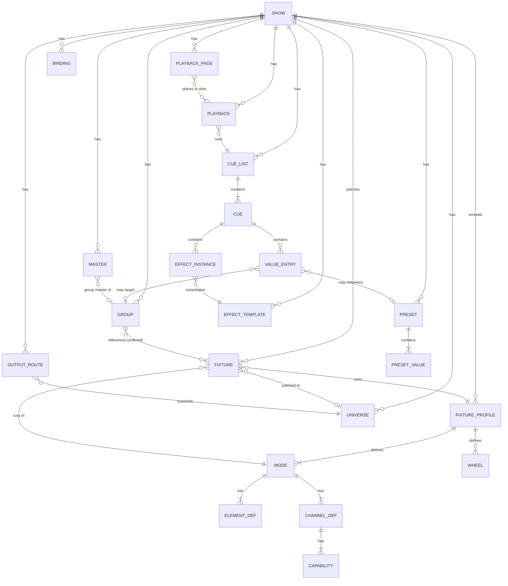

# Busking Lighting Console — Software Architecture & Data Model

| | |
|---|---|
| **Document type** | Technical design / implementation specification |
| **Scope** | Real-time busking lighting console: show data model, playback engine, attribute resolver, effects, output |
| **Output protocols** | DMX512 (USB interfaces), Art-Net 4, sACN (ANSI E1.31) |
| **Schema notation** | Python 3.12+ type hints: `TypedDict` for JSON data (show file, commands), `@dataclass` for in-engine structures (notation only — the engine may be written in any language) |
| **Status** | Draft v2 |

---

## Table of contents

1. [Purpose and scope](#1-purpose-and-scope)
2. [Design principles](#2-design-principles)
3. [Glossary](#3-glossary)
4. [System overview](#4-system-overview)
5. [Data model](#5-data-model)
6. [Compilation: from show data to engine slots](#6-compilation-from-show-data-to-engine-slots)
7. [The attribute resolver](#7-the-attribute-resolver)
8. [Playback behaviour](#8-playback-behaviour)
9. [Cue list engine](#9-cue-list-engine)
10. [Effect engine](#10-effect-engine)
11. [Time, tempo and the engine loop](#11-time-tempo-and-the-engine-loop)
12. [Masters, blackout and the safety stage](#12-masters-blackout-and-the-safety-stage)
13. [Fixture profile conversion (logical → DMX)](#13-fixture-profile-conversion-logical--dmx)
14. [Output engine](#14-output-engine)
15. [Commands, undo and the event log](#15-commands-undo-and-the-event-log)
16. [Process and threading architecture](#16-process-and-threading-architecture)
17. [Persistence and versioning](#17-persistence-and-versioning)
18. [Safety and failure behaviour](#18-safety-and-failure-behaviour)
19. [Performance budget](#19-performance-budget)
20. [Testing strategy](#20-testing-strategy)
21. [Code organisation](#21-code-organisation)
22. [Implementation roadmap](#22-implementation-roadmap)
23. [Open design decisions](#23-open-design-decisions)
- [Appendix A — Example show file](#appendix-a--example-show-file)
- [Appendix B — Changes from the previous draft](#appendix-b--changes-from-the-previous-draft)

---

## 1. Purpose and scope

A busking console lets an operator *improvise* lighting live, layering looks, colours, positions, beam states, effects and flashes in real time, the way a musician plays an instrument. Unlike a channel-per-fader DMX controller, it works with **intent** ("moving heads, blue, audience, pulse") and turns that intent into DMX at the very end of a deterministic pipeline.

This document specifies enough to build such a system:

- the **persistent show data model** (what is saved to disk),
- the **runtime model** (what exists only while the engine runs),
- the **algorithms** that combine many simultaneous sources into one value per fixture attribute,
- the **conversion and transport** of those values to DMX512, Art-Net and sACN.

### 1.1 Goals

- Any number of simultaneous playbacks contributing partial state, with well-defined, predictable merging (HTP / LTP / priority).
- Fades, cue stacks, chases and effects that are time-based, tempo-syncable and frame-rate independent.
- A fixture abstraction rich enough for real fixtures: 16-bit channels, multi-cell (pixel) fixtures, colour wheels, gobo wheels, shutters, fixtures without a dimmer channel.
- One engine, many control surfaces (touchscreen, MIDI, OSC, web, hardware).
- Live-safe: the output never stalls or blacks out because the UI crashed.

### 1.2 Non-goals (for v1)

- 3D visualisation, pixel mapping from video, timecode-driven shows, multi-console networking/backup, merging external DMX input. The data model leaves room for these (see §23).

---

## 2. Design principles

1. **A playback is a source of intent, never a DMX channel.** Show data stores logical attribute values ("pan = 45°", "colour = blue", "gobo = breakup"). DMX exists only after the last pipeline stage.
2. **Everything that produces values is a *source*.** Playbacks, cue lists, chases, the programmer, flashes and effects all produce the same thing — *contributions* to attribute slots — and are combined by **one** resolver. There is no second, special-case code path.
3. **Partial state.** Every source stores only the attributes it controls. A colour look contains colour and nothing else. This is what makes layering possible.
4. **References, not copies.** Groups reference fixtures; looks reference presets. Updating the "Blue" preset updates every look that uses it.
5. **Time, not frames.** All motion derives from a monotonic clock and accumulated phase. Changing the engine rate never changes how a show looks.
6. **The engine owns the state.** UIs send commands and display snapshots. They never mutate state directly.
7. **Determinism.** Given the same show, the same command sequence and the same clock, the engine produces byte-identical output. This makes the system testable.
8. **Non-destructive masters.** Grand master, blackout, flash and park modify *output*, never the underlying state.

---

## 3. Glossary

| Term | Meaning |
|---|---|
| **Fixture** | A patched instance of a lighting device. |
| **Fixture profile** | Library definition of a device model: modes, channels, wheels, physical ranges. |
| **Mode** | One DMX personality of a profile (e.g. "16-ch basic", "32-ch extended"). |
| **Element** | An individually controllable part of a fixture (a pixel of a bar, a cell of a multi-head). Single-cell fixtures have exactly one element. |
| **Target** | A `(fixture, element)` pair — the smallest thing an attribute belongs to. |
| **Attribute** | A logical property of a target: intensity, pan, colour, gobo, zoom… |
| **Slot** | A compiled `(target, attribute)` pair with a dense integer index; the unit the resolver works on. |
| **Lane** | One float inside a slot (a colour slot has several lanes: r, g, b, optional w/a/uv). |
| **Preset** (palette) | A named, reusable set of attribute values, e.g. "Blue", "Audience", "Tight beam". |
| **Cue** | One state in a cue list: value entries + effects + timing. |
| **Cue list** | An ordered list of cues. A single-cue cue list is a "look"; a cue list in chase mode is a "chase". |
| **Playback** | A performance handle that runs one cue list, with fader/button behaviour and a priority. |
| **Contribution** | What a running source offers for one slot this tick: value, weight, priority, sequence. |
| **Priority band** | All contributions sharing the same priority number. |
| **HTP / LTP** | Highest-takes-precedence / latest-takes-precedence merge rules. |
| **Weight** | 0..1 "how present" a contribution is, driven by fades and LTP fader modes. |
| **Programmer** | The temporary editing buffer the operator uses to build values before recording. |
| **Tracking** | A cue list behaviour where values persist into later cues until changed. |
| **Park** | A value forced at output regardless of everything else (e.g. a broken fixture held at 0). |

---

## 4. System overview

### 4.1 Layered view

```
 ┌────────────────────────────────────────────────────────────────────┐
 │  CONTROL SURFACES   touchscreen · MIDI · OSC · web · hardware      │
 └──────────────────────────────┬─────────────────────────────────────┘
                                │  bindings → Commands
 ┌──────────────────────────────▼─────────────────────────────────────┐
 │  COMMAND BUS        validation · undo (show edits) · event log     │
 └──────────────────────────────┬─────────────────────────────────────┘
                                │
 ┌──────────────────────────────▼─────────────────────────────────────┐
 │  SHOW STORE         fixtures · groups · presets · cue lists ·      │
 │  (persistent)       playbacks · effects · masters · bindings       │
 └──────────────────────────────┬─────────────────────────────────────┘
                                │  compile (on change)
 ┌──────────────────────────────▼─────────────────────────────────────┐
 │  COMPILED SHOW      slot table · expanded cues · tracked states    │
 └──────────────────────────────┬─────────────────────────────────────┘
                                │
 ┌──────────────────────────────▼─────────────────────────────────────┐
 │  ENGINE (fixed tick, single owner of runtime state)                │
 │   playback runtimes → cue/fade progress → effect phase             │
 │   → contributions → RESOLVER (priority, HTP, LTP, relative fx)     │
 │   → masters → blackout → park/limits                               │
 └──────────────────────────────┬─────────────────────────────────────┘
                                │  logical frame (floats per slot)
 ┌──────────────────────────────▼─────────────────────────────────────┐
 │  PROFILE CONVERSION  colour mixing · wheels · 16-bit · curves      │
 └──────────────────────────────┬─────────────────────────────────────┘
                                │  universe buffers (512 bytes each)
 ┌──────────────────────────────▼─────────────────────────────────────┐
 │  OUTPUT ENGINE      DMX USB · Art-Net · sACN (own rate & thread)   │
 └────────────────────────────────────────────────────────────────────┘
```

### 4.2 Per-tick pipeline (authoritative order)

The previous draft drew the effect engine *after* the priority engine. That is ambiguous: absolute effects must take part in merging, while relative effects must be applied on top of the merged result. The authoritative order is:

| # | Stage | Output |
|---|---|---|
| 1 | Drain command queue | Updated runtime state (triggers, releases, fader levels, programmer edits) |
| 2 | Advance clocks | `now`, `dt`, beat phase per speed master |
| 3 | Advance playbacks / cue lists | Cue transitions, follow/wait triggers, chase steps |
| 4 | Advance fades | Weights and interpolated values for every live contribution |
| 5 | Advance effects | Phase per effect; absolute values and relative offsets per member |
| 6 | Gather contributions | Per-slot lists sorted by `(priority, sequence)` |
| 7 | Resolve — absolute pass | HTP/LTP composite per slot |
| 8 | Resolve — relative pass | Add/multiply relative effects that are not masked by a higher band |
| 9 | Intensity masters | Group masters, grand master |
| 10 | Blackout | Intensity → 0 (state untouched) |
| 11 | Safety stage | Park values, pan/tilt limits, strobe-rate cap, highlight |
| 12 | Profile conversion | Logical values → DMX bytes in universe buffers |
| 13 | Publish frame | Swap buffers for the output thread; publish UI snapshot |

---

## 5. Data model

This is the core of the design. Everything in §5.1–§5.17 is **persistent show data**. §5.18 is **runtime state** and is never saved.

### 5.1 Conventions

**Identifiers.** Every entity has an immutable opaque `id` (UUID or ULID) used for all references, plus — where operators address it — a user-facing `number` that can be renumbered freely without breaking references.

```python
# Shared by every Python block in this document (Python ≥ 3.12).
from __future__ import annotations

from dataclasses import dataclass
from typing import Generic, Literal, NewType, NotRequired, Protocol, TypedDict, TypeVar

import numpy as np
from numpy.typing import NDArray

FixtureId   = NewType("FixtureId", str)
ProfileId   = NewType("ProfileId", str)
ModeId      = NewType("ModeId", str)
GroupId     = NewType("GroupId", str)
PresetId    = NewType("PresetId", str)
CueListId   = NewType("CueListId", str)
CueId       = NewType("CueId", str)
PlaybackId  = NewType("PlaybackId", str)
EffectId    = NewType("EffectId", str)
MasterId    = NewType("MasterId", str)
UniverseId  = NewType("UniverseId", str)
SurfaceId   = NewType("SurfaceId", str)
type AttributeId = str                    # from the attribute registry (§5.3)

TId = TypeVar("TId")

class EntityBase(TypedDict, Generic[TId]):
    id: TId
    name: str
    notes: NotRequired[str]
    tags: NotRequired[list[str]]
```

**Units.** Show data stores *physical/logical* units, never DMX values:

| Quantity | Unit | Range / notes |
|---|---|---|
| Intensity | normalised | 0.0 – 1.0 |
| Pan, tilt | degrees | relative to the fixture's mechanical centre (0° = home) |
| Zoom, iris (beam angle) | degrees or normalised | per attribute definition |
| Focus, frost, CTO… | normalised | 0.0 – 1.0 |
| Colour | linear RGB, 0.0 – 1.0 per component | see `ColorValue` |
| Rates | Hz | or BPM-relative (see `Rate`) |
| Times | seconds (float) | |
| Phase | degrees | 0 – 360 |
| Stage positions | metres | x right, y downstage, z up |

**Schema version.** The show root carries `schemaVersion`; every structural change ships with a migration (§17).

### 5.2 Entity overview



### 5.3 Attribute registry

Attributes are the shared vocabulary between show data, the resolver and fixture profiles. The registry is static (compiled into the application) and versioned with the schema.

```python
type AttributeFamily = Literal[
    "intensity", "position", "color", "beam", "focus",
    "shutter", "control",
]

type ValueKind = Literal["scalar", "color", "discrete"]

@dataclass(kw_only=True)
class ScalarRange:
    min: float
    max: float

@dataclass(kw_only=True)
class AttributeDefinition:
    id: AttributeId
    family: AttributeFamily
    kind: ValueKind
    unit: Literal["normalized", "degrees", "hz", "degPerSec", "none"]
    range: ScalarRange | None = None                 # scalar only; logical range
    merge: Literal["HTP", "LTP"]
    fade: Literal["fade", "snap"]                    # discrete values always snap
    snapAt: Literal["start", "middle", "end"] | None = None  # default "start"
    wraps: bool | None = None                        # e.g. continuous rotation index
    default: AttributeValue                          # value when no source controls the slot
    home: AttributeValue | None = None               # optional "home" used by the HOME command
    followsChannel: bool = False                     # scalar: start at the channel's defaultDmx
```

**Built-in catalogue (v1):**

| Attribute | Family | Kind | Unit | Merge | Fade | Default |
|---|---|---|---|---|---|---|
| `intensity` | intensity | scalar | normalised | **HTP** | fade | 0 |
| `pan` | position | scalar | degrees | LTP | fade | 0 |
| `tilt` | position | scalar | degrees | LTP | fade | 0 |
| `positionSpeed` | position | scalar | normalised | LTP | snap | 0 (fastest) |
| `color` | color | color | linear RGB | LTP | fade | white `{1,1,1}` |
| `colorWheel` | color | discrete | — | LTP | snap | open |
| `cto` | color | scalar | normalised | LTP | fade | 0 |
| `colorMacro` | color | discrete | — | LTP | snap | the channel's default option |
| `colorMacroRate` | color | scalar | normalised | LTP | fade | the channel's, else 0.5 (0 slowest, 1 fastest) |
| `colorEffect` | color | discrete | — | LTP | snap | the channel's default option |
| `gobo1`, `gobo2` | beam | discrete | — | LTP | snap | open |
| `gobo1Rotation`, `gobo2Rotation` | beam | scalar | degPerSec | LTP | fade | 0 |
| `prism` | beam | discrete | — | LTP | snap | off |
| `prismRotation` | beam | scalar | degPerSec | LTP | fade | 0 |
| `zoom` | beam | scalar | degrees | LTP | fade | profile midpoint |
| `iris` | beam | scalar | normalised | LTP | fade | 1 (open) |
| `frost` | beam | scalar | normalised | LTP | fade | 0 |
| `effect`, `effect2` | beam | discrete | — | LTP | snap | the channel's default option |
| `effectRate` | beam | scalar | normalised | LTP | fade | the channel's, else 0.5 (0 slowest, 1 fastest) |
| `effectFade` | beam | scalar | normalised | LTP | snap | the channel's, else 0 (snap or shortest) |
| `effectAdjust` | beam | scalar | normalised | LTP | fade | the channel's, else 0.5 |
| `effectRotation` | beam | scalar | degPerSec | LTP | fade | the channel's, else 0 |
| `effectSync` | beam | scalar | normalised | LTP | snap | the channel's, else 0 |
| `soundSensitivity` | beam | scalar | normalised | LTP | snap | the channel's, else 0 (off or lowest) |
| `focus` | focus | scalar | normalised | LTP | fade | 0.5 |
| `shutter` | shutter | discrete | — | LTP | snap | `open` |
| `strobeRate` | shutter | scalar | hz | LTP | fade | 0 |
| `control` | control | discrete | — | LTP | snap | none (lamp on, reset… — never busked) |

> **Why colour is one attribute, not R/G/B:** presets, fades and effects operate on colour as a whole, and fixtures mix colour very differently (RGB, RGBW, RGBA+UV, CMY, colour wheel). The show stores *the colour you want*; the profile decides *how to make it* (§13.3). Explicit emitter control (e.g. "UV only") is still possible through the optional extra components of `ColorValue`.

### 5.4 Values

```python
type AttributeValue = float | ColorValue | DiscreteValue

class ColorValue(TypedDict):
    r: float                             # linear RGB 0..1 — the target colour
    g: float
    b: float
    w: NotRequired[float]                # optional explicit extra emitters; when
    a: NotRequired[float]                # absent the profile derives them
    uv: NotRequired[float]

class DiscreteValue(TypedDict):
    wheel: NotRequired[str]              # wheel id within the profile (gobo/colour/prism)
    slot: str                            # stable slot id, e.g. "open", "breakup", "red"
    # For `shutter`: slot ∈ "open" | "closed" | "strobe" | "pulse" | "random"
```

Values in show data are always one of these. Compiled values become float **lanes** (§6.2).

### 5.5 Fixture profiles (library)

A profile describes a fixture *model*. It is embedded in the show file (so shows are portable), and ideally imported from **GDTF** or the **Open Fixture Library** rather than authored by hand.

```python
class FixturePhysical(TypedDict, total=False):
    panRange: float                           # total mechanical travel, degrees (e.g. 540)
    tiltRange: float                          # e.g. 270
    zoomRange: tuple[float, float]            # beam angle min/max, degrees
    maxStrobeHz: float
    powerW: float
    weightKg: float

class FixtureProfile(EntityBase[ProfileId]):
    manufacturer: str
    model: str
    revision: str                             # bump when edited; shows record it
    source: Literal["gdtf", "ofl", "user"]
    physical: FixturePhysical
    wheels: list[Wheel]
    emitters: NotRequired[list[Emitter]]      # for additive/subtractive mixing (§13.3)
    modes: list[FixtureMode]

class Wheel(TypedDict):
    id: str                                   # "color1", "gobo1", "prism1"
    kind: Literal["color", "gobo", "prism", "animation"]
    slots: list[WheelSlot]

class WheelSlot(TypedDict):
    id: str                                   # stable: "open", "red", "breakup"
    name: str
    color: NotRequired[ColorValue]            # colour wheels: measured approximate colour
    facets: NotRequired[int]                  # prisms
    image: NotRequired[str]                   # gobo thumbnail (asset path)

class Emitter(TypedDict):
    id: (Literal["red", "green", "blue", "white", "amber", "lime", "cyan",
                 "uv", "cyanFlag", "magentaFlag", "yellowFlag"] | str)
    color: ColorValue                         # emitter colour in linear RGB (calibration)
    subtractive: NotRequired[bool]            # CMY flags

class FixtureMode(TypedDict):
    id: ModeId
    name: str                                 # "Extended 32ch"
    footprint: int                            # DMX channels used
    elements: list[ElementDefinition]         # ≥ 1; index 0 is the "main" element
    intensityStrategy: Literal["dimmerChannel", "virtual"]  # virtual = scale emitters (§13.2)
    dimmerCurve: NotRequired[Literal["linear", "square", "invSquare", "sCurve"]
                             | list[float]]   # table 0..1
    channels: list[ChannelDefinition]

class ElementLayout(TypedDict):
    x: float
    y: float

class ElementDefinition(TypedDict):
    index: int                                # 0..n-1
    name: str                                 # "Main", "Cell 1"…
    layout: NotRequired[ElementLayout]        # relative position for pixel layouts

class ChannelDefinition(TypedDict):
    offset: int                               # 0-based within the footprint (coarse byte)
    element: int                              # element index
    attribute: AttributeId
    component: NotRequired[str]               # for colour: emitter id ("red", "white", "cyanFlag")
    bytes: Literal[1, 2, 3]                   # coarse, +fine, +ultra
    fineOffsets: NotRequired[list[int]]       # usually [offset+1]; NOT always adjacent
    defaultDmx: int                           # value when unpatched-from-busking (raw)
    highlightDmx: NotRequired[int]            # value used by the highlight function
    invert: NotRequired[bool]                 # 255 = minimum (common on dimmers of old fixtures)
    capabilities: list[Capability]            # ordered, non-overlapping DMX ranges

class RangeCapability(TypedDict):             # linear map of a logical sub-range
    kind: Literal["range"]
    dmx: tuple[int, int]                      # inclusive, in the channel's full resolution
    value: tuple[float, float]                # logical units of the attribute

class SlotCapability(TypedDict):              # wheel / discrete position
    kind: Literal["slot"]
    dmx: tuple[int, int]
    wheel: NotRequired[str]
    slot: str

class CapabilityParam(TypedDict):
    attribute: AttributeId
    value: tuple[float, float]

class FunctionCapability(TypedDict):          # shutter & special modes
    kind: Literal["function"]
    dmx: tuple[int, int]
    fn: (Literal["open", "closed", "strobe", "pulse", "random", "reset", "lampOn", "lampOff"]
         | str)
    param: NotRequired[CapabilityParam]       # e.g. strobe 1–20 Hz

type Capability = RangeCapability | SlotCapability | FunctionCapability
```

**Profile rules**

- A mode exposes the set of `(element, attribute)` pairs that become slots at compile time. An attribute appears once per element (its fine/ultra bytes are part of the same channel definition).
- `fineOffsets` exists because many fixtures put fine channels in a separate block.
- Mixed channels (one DMX channel holding gobo slots *and* gobo shake) are expressed as multiple capabilities on the same channel; the converter picks the capability matching the logical value (§13).
- `control` attributes (lamp on, reset) are reachable only through explicit commands, never through busking playbacks.

### 5.6 Patch: universes and fixtures

```python
class Universe(EntityBase[UniverseId]):
    number: int                               # logical universe number, 1-based

class Orientation(TypedDict):
    invertPan: bool
    invertTilt: bool
    swapPanTilt: bool
    panOffset: float                          # degrees added before conversion
    tiltOffset: float

class FixtureLimits(TypedDict, total=False):
    pan: tuple[float, float]                  # degrees, enforced at the safety stage
    tilt: tuple[float, float]
    intensityMax: float                       # 0..1

class Location(TypedDict):
    x: float
    y: float
    z: float
    rx: float
    ry: float
    rz: float

class Fixture(EntityBase[FixtureId]):
    number: int                               # user-facing fixture number (e.g. 101)
    profileId: ProfileId
    profileRevision: str                      # detects library drift
    modeId: ModeId
    patch: PatchAddress | None                # None = unpatched (still programmable)
    elementPatch: NotRequired[dict[int, PatchAddress]]  # optional per-element split patch (pixel bars)
    orientation: Orientation
    limits: NotRequired[FixtureLimits]
    location: NotRequired[Location]

class PatchAddress(TypedDict):
    universeId: UniverseId
    address: int                              # 1..512, start channel
```

**Targets** are how everything else points at fixtures:

```python
class TargetRef(TypedDict):
    fixtureId: FixtureId
    element: int                              # 0 for single-element fixtures

# Canonical string key used in maps and logs: f"{fixtureId}:{element}"
type TargetKey = str
```

Patch validation (performed on every patch edit): footprint fits in the universe (`address + footprint − 1 ≤ 512`), no overlaps (warn, allow — double-patching is legitimate for some setups), profile revision present.

### 5.7 Groups

```python
class GroupLayout(TypedDict):
    width: int
    height: int
    cells: list[int | None]                   # index into members, row-major

class Group(EntityBase[GroupId]):
    number: int
    members: list[TargetRef]                  # ORDERED — order drives fans and effect phase
    layout: NotRequired[GroupLayout]          # optional 2D layout for matrix effects
    uiColor: NotRequired[str]
```

- Groups **reference** targets; they never copy fixture data.
- A group may contain whole fixtures (element 0) or individual cells of multi-element fixtures.
- Member order matters: "left to right" vs "outside in" produces different fans and effect waves. Provide UI tools to reorder (by fixture number, by stage x, reverse, mirror).

### 5.8 Presets (palettes)

A preset is a reusable, named bundle of attribute values. Its values can be **scoped** so one preset works for heterogeneous rigs:

```python
type PresetPool = Literal["intensity", "position", "color", "beam", "focus", "all"]

class Preset(EntityBase[PresetId]):
    number: int
    pool: PresetPool                          # which preset pool it lives in
    values: list[PresetValue]

class GlobalScope(TypedDict):                 # any fixture that has the attribute
    kind: Literal["global"]

class ProfileScope(TypedDict):                # all fixtures of one model
    kind: Literal["profile"]
    profileId: ProfileId

class TargetScope(TypedDict):                 # one specific fixture/element
    kind: Literal["target"]
    target: TargetRef

class PresetValue(TypedDict):
    scope: GlobalScope | ProfileScope | TargetScope
    attribute: AttributeId
    value: AttributeValue
```

**Lookup rule** when a target asks a preset for an attribute: `target` scope → `profile` scope → `global` scope → *not defined* (the entry contributes nothing to that target).

- Colour presets are typically **global** (blue is blue on every fixture; each profile mixes it differently).
- Position presets are typically **per target** (each moving head is hung differently, so "Audience" is a different pan/tilt per fixture).
- Beam presets are typically **per profile** (gobo slot ids differ by model).
- Presets contain no timing and cannot reference other presets (no cycles).

### 5.9 Value entries — the unit of stored intent

Cues and the programmer store **value entries**. A value entry says *which targets*, *which attribute*, *what value*, and optionally *what timing*.

```python
class TargetList(TypedDict):                          # fixed list
    kind: Literal["targets"]
    refs: list[TargetRef]

class GroupTarget(TypedDict):                         # live reference — follows group edits
    kind: Literal["group"]
    groupId: GroupId

type TargetSpec = TargetList | GroupTarget

class LiteralSource(TypedDict):                       # same value for all targets
    kind: Literal["literal"]
    value: AttributeValue

class PerTargetSource(TypedDict):
    kind: Literal["perTarget"]
    values: dict[TargetKey, AttributeValue]

class PresetSource(TypedDict):                        # resolved per target at compile time
    kind: Literal["preset"]
    presetId: PresetId

SpreadSource = TypedDict("SpreadSource", {            # fan across ordered targets
    "kind": Literal["spread"],                        # (functional syntax: `from` is a Python keyword)
    "from": AttributeValue,
    "to": AttributeValue,
    "curve": NotRequired[Literal["linear", "center", "edges"]],
})

type ValueSource = LiteralSource | PerTargetSource | PresetSource | SpreadSource

class ValueEntry(TypedDict):
    targets: TargetSpec
    attribute: AttributeId
    value: ValueSource
    timing: NotRequired[TimingOverride]               # per-entry fade/delay

class TimingOverride(TypedDict, total=False):
    fade: float                                       # seconds
    delay: float
    curve: FadeCurve

class BezierCurve(TypedDict):
    bezier: tuple[float, float, float, float]

type FadeCurve = (
    Literal["linear", "easeIn", "easeOut", "easeInOut",   # easeInOut = smoothstep t²(3−2t)
            "snapStart", "snapEnd"]
    | BezierCurve
)
```

**Busking recommendation:** record with `{"kind": "group"}` and `{"kind": "preset"}` whenever possible. Then adding a fixture to the "Moving Heads" group, or retouching the "Audience" position, automatically updates every look that uses them.

### 5.10 Effects

Effects are split into a reusable **template** (the shape) and an **instance** (where it's applied, how fast, how big, how spread).

```python
class EffectTemplate(EntityBase[EffectId]):
    layers: list[EffectLayer]                 # e.g. circle = pan(cos) + tilt(sin)

class ScalarLayer(TypedDict):                 # scalar attributes
    attribute: AttributeId
    waveform: Waveform
    phaseOffset: float                        # degrees, within the template (tilt +90° for circles)
    mode: Literal["absolute", "add", "multiply"]

class PresetRef(TypedDict):
    presetId: PresetId

class ColorLayer(TypedDict):                  # colour cycles
    attribute: Literal["color"]
    palette: list[ColorValue | PresetRef]
    blend: Literal["fade", "snap"]
    mode: Literal["absolute"]

type EffectLayer = ScalarLayer | ColorLayer

SineWave     = TypedDict("SineWave",     {"kind": Literal["sine"]})
TriangleWave = TypedDict("TriangleWave", {"kind": Literal["triangle"]})
SquareWave   = TypedDict("SquareWave",   {"kind": Literal["square"], "duty": float})        # 0..1
SawUpWave    = TypedDict("SawUpWave",    {"kind": Literal["sawUp"]})
SawDownWave  = TypedDict("SawDownWave",  {"kind": Literal["sawDown"]})
PulseWave    = TypedDict("PulseWave",    {"kind": Literal["pulse"], "width": float,
                                          "attack": float, "decay": float})
StepWave     = TypedDict("StepWave",     {"kind": Literal["step"], "steps": list[float]})   # levels 0..1, equal time each
RandomWave   = TypedDict("RandomWave",   {"kind": Literal["random"], "smooth": bool, "seed": int})
CurveWave    = TypedDict("CurveWave",    {"kind": Literal["curve"],
                                          "points": list[tuple[float, float]]})             # x,y in 0..1

type Waveform = (SineWave | TriangleWave | SquareWave | SawUpWave | SawDownWave
                 | PulseWave | StepWave | RandomWave | CurveWave)

class HzRate(TypedDict):
    kind: Literal["hz"]
    value: float

class BpmRate(TypedDict):
    kind: Literal["bpm"]
    masterId: MasterId
    multiplier: float                         # 0.25 = every 4 beats

type Rate = HzRate | BpmRate

class EffectPhase(TypedDict):
    start: float
    end: float

class EffectInstance(TypedDict):
    id: str
    templateId: EffectId
    targets: TargetSpec
    rate: Rate
    direction: Literal["forward", "reverse", "bounce"]
    # amplitude
    size: float                               # attribute units for add; 0..1 for multiply
    low: NotRequired[AttributeValue]          # absolute mode: wave 0 → low, 1 → high
    high: NotRequired[AttributeValue]
    # distribution across ordered members
    phase: EffectPhase                        # degrees, e.g. 0 → 360 = full wave
    groups: int                               # ≥1: members cycle through N phase groups
    blocks: int                               # ≥1: N consecutive members share a phase
    wings: int                                # ≥1: mirror the phase pattern N times
    # dynamics
    sizeFadeIn: NotRequired[float]            # seconds for size to ramp up
    sizeMasterId: NotRequired[MasterId]
    speedMasterId: NotRequired[MasterId]
```

**Absolute vs relative.** An `absolute` layer *is* the value (an intensity chase, a colour cycle) and takes part in normal merging. An `add` layer offsets whatever value the slot resolves to (a circle around the current position). A `multiply` layer scales it (an intensity pulse that dims whatever look is up). See §7.7.

### 5.11 Cue lists and cues

The previous draft treated playbacks, cues and chases as different architectures. Here they are unified: **every playback runs a cue list.**

| Concept | Representation |
|---|---|
| Look / "bump" (Blue, Audience) | cue list with 1 cue |
| Song stack (Intro → Verse → Chorus) | cue list in `sequence` mode, GO-driven |
| Chase | cue list in `chase` mode, rate-driven |
| Effect playback (Pulse) | cue list with 1 cue containing only an effect instance |

```python
class ChaseSettings(TypedDict):
    rate: Rate
    direction: Literal["forward", "reverse", "bounce", "random"]
    crossfade: float                          # 0..1 of step time spent fading

class CueList(EntityBase[CueListId]):
    number: int
    mode: Literal["sequence", "chase"]
    tracking: bool                            # values persist until changed (§9.3)
    wrap: bool                                # after last cue: wrap to first, or stay/release
    releaseAtEnd: bool                        # GO past last cue releases the playback
    chase: NotRequired[ChaseSettings]
    cues: list[Cue]                           # sorted by `number`

class CueRelease(TypedDict):
    targets: TargetSpec
    attributes: list[AttributeId] | Literal["all"]

class GoTrigger(TypedDict):
    kind: Literal["go"]

class FollowTrigger(TypedDict):               # auto-GO `delay` s after previous cue *completes*
    kind: Literal["follow"]
    delay: float

class WaitTrigger(TypedDict):                 # auto-GO `delay` s after previous cue *starts*
    kind: Literal["wait"]
    delay: float

class Cue(TypedDict):
    id: CueId
    number: str                               # decimal as string: "1", "1.5", "12.25"
    name: str
    entries: list[ValueEntry]
    effects: list[EffectInstance]
    releases: NotRequired[list[CueRelease]]   # explicit release
    block: NotRequired[bool]                  # tracking stop: this cue is a full hard state
    timing: CueTiming
    trigger: GoTrigger | FollowTrigger | WaitTrigger

class FamilyTiming(TypedDict):
    fade: float
    delay: float
    curve: NotRequired[FadeCurve]

class CueTiming(TypedDict):
    fadeIn: float                             # intensity rising & all LTP attributes
    fadeOut: float                            # intensity falling
    delayIn: float
    delayOut: float
    curve: FadeCurve
    perFamily: NotRequired[dict[AttributeFamily, FamilyTiming]]
```

Cue numbers are strings to avoid floating-point surprises (`"1.10"` vs `"1.1"`); sort by numeric value of the parts.

### 5.12 Playbacks

A playback is a *performance handle* around a cue list: how it reacts to its fader and buttons and how it competes with other sources.

```python
type FaderFunction = Literal[
    "master",        # scales intensity; LTP per `ltpFaderMode`
    "crossfade",     # fader position = progress of the next cue transition
    "rate",          # chase / effect speed
    "size",          # effect size
    "temp",          # fader acts as a variable-level flash
    "none",
]

type ButtonFunction = Literal[
    "go", "back", "goto",
    "flash",         # on while held, released on button-up
    "swop",          # flash + suppress all other intensity
    "toggle",        # on/off
    "release",
    "select",        # select this playback's targets in the programmer
    "none",
]

class PlaybackFlash(TypedDict):
    level: float                              # usually 1.0
    includeLtp: bool                          # does a flash also bring LTP values?
    priorityBoost: NotRequired[int]           # optional: flash contributes at a higher band

class Playback(EntityBase[PlaybackId]):
    number: int
    cueListId: CueListId
    priority: int                             # band; see §7.2 for recommended values
    fader: FaderFunction
    buttons: list[ButtonFunction]             # physical button 1..n under the fader
    ltpFaderMode: Literal[
        "followFader",   # LTP weight = fader level (crossfades position/colour with the fader)
        "threshold",     # LTP snaps in (with cue timing) when fader passes `ltpThreshold`
        "ignoreFader",   # LTP fully present while active; fader only scales intensity
    ]
    ltpThreshold: float                       # default 0.02
    autoStart: bool                           # fader leaving 0 triggers the playback
    autoRelease: bool                         # fader reaching 0 releases it
    flash: PlaybackFlash
    exclusivity: NotRequired[str]             # playbacks sharing a key release each other
    protectFromSwop: bool
    releaseTime: float                        # seconds; LTP fades back to what's underneath
    uiColor: NotRequired[str]

class PlaybackPage(EntityBase[str]):
    number: int
    slots: list[PlaybackId | None]            # index = physical slot on the surface
```

**Exclusivity** solves a real busking problem: with plain LTP, if *Red* is triggered, then *Blue*, then *Blue* is released, the stale *Red* reappears. Putting all colour bumps in `exclusivity: "color"` makes triggering *Blue* release *Red*, so releasing *Blue* falls back to the base look as the operator expects.

Changing pages **does not** affect running playbacks; a fader that controls a running playback on another page uses soft-takeover (§5.15).

### 5.13 Masters

```python
class GrandMaster(EntityBase[MasterId]):
    kind: Literal["grand"]

class GroupMaster(EntityBase[MasterId]):      # scales intensity of members
    kind: Literal["group"]
    groupId: GroupId

class SpeedMaster(EntityBase[MasterId]):
    kind: Literal["speed"]
    defaultBpm: float
    tap: bool
    multiplierSteps: list[float]              # e.g. [0.25,0.5,1,2,4]

class SizeMaster(EntityBase[MasterId]):
    kind: Literal["size"]

class FadeTimeMaster(EntityBase[MasterId]):   # global fade override
    kind: Literal["fadeTime"]

type Master = GrandMaster | GroupMaster | SpeedMaster | SizeMaster | FadeTimeMaster
```

Master *levels* are runtime state (§5.18), but the show stores their last level for convenience on load (`initialLevel`, optional).

### 5.14 Programmer

The programmer is runtime state, but it is **autosaved** (separately from the show) so a crash does not lose work in progress.

```python
@dataclass(kw_only=True)
class ProgrammerState:
    selection: list[TargetRef]                # ordered — selection order drives fans/effects
    values: dict[SlotKey, ProgrammerValue]    # SlotKey = f"{TargetKey}/{AttributeId}"
    effects: list[EffectInstance]
    mode: Literal["live", "blind"]            # blind: edits don't reach output
    highlight: bool                           # selected targets forced to highlight values
    fadeTime: float                           # seconds applied to programmer changes
    priority: int                             # default 100 (above playbacks)
    history: list[ProgrammerSnapshot]         # local undo stack

@dataclass(kw_only=True)
class ProgrammerValue:
    source: ValueSource                       # literal or preset reference (kept as reference!)
    active: bool                              # "touched" values are recorded; inactive ones aren't
    touchedSeq: int                           # LTP ordering
```

Keeping preset references in the programmer is essential: if the operator selects "Blue" and records, the cue stores `{"kind": "preset"}`, not the RGB numbers.

### 5.15 Control surfaces and bindings

```python
class SurfaceMatch(TypedDict, total=False):
    deviceName: str
    port: int
    host: str

class ControlSurface(EntityBase[SurfaceId]):
    kind: Literal["midi", "osc", "hid", "web", "internal"]
    match: SurfaceMatch
    faderPickup: Literal["jump", "soft"]      # soft takeover for non-motorised faders

MidiCC        = TypedDict("MidiCC",        {"kind": Literal["midiCC"], "channel": int, "cc": int})
MidiNote      = TypedDict("MidiNote",      {"kind": Literal["midiNote"], "channel": int, "note": int})
MidiPitchBend = TypedDict("MidiPitchBend", {"kind": Literal["midiPitchBend"], "channel": int})  # 14-bit faders
OscInput      = TypedDict("OscInput",      {"kind": Literal["osc"], "path": str})
HwInput       = TypedDict("HwInput",       {"kind": Literal["hw"], "controlId": str})

type InputAddress = MidiCC | MidiNote | MidiPitchBend | OscInput | HwInput

FaderAction    = TypedDict("FaderAction",    {"kind": Literal["playbackFader"], "slot": int})  # page-relative
ButtonAction   = TypedDict("ButtonAction",   {"kind": Literal["playbackButton"], "slot": int, "button": int})
FaderAbsAction = TypedDict("FaderAbsAction", {"kind": Literal["playbackFaderAbs"], "playbackId": PlaybackId})
MasterAction   = TypedDict("MasterAction",   {"kind": Literal["master"], "masterId": MasterId})
TapAction      = TypedDict("TapAction",      {"kind": Literal["tap"], "masterId": MasterId})
PageAction     = TypedDict("PageAction",     {"kind": Literal["page"], "delta": int})
PageAbsAction  = TypedDict("PageAbsAction",  {"kind": Literal["pageAbs"], "number": int})
BlackoutAction = TypedDict("BlackoutAction", {"kind": Literal["blackout"]})
CommandAction  = TypedDict("CommandAction",  {"kind": Literal["command"], "command": "Command"})

type Action = (FaderAction | ButtonAction | FaderAbsAction | MasterAction | TapAction
               | PageAction | PageAbsAction | BlackoutAction | CommandAction)

class BindingFeedback(TypedDict):
    kind: Literal["led", "motorFader", "display"]
    address: InputAddress

class Binding(TypedDict):
    id: str
    surfaceId: SurfaceId
    input: InputAddress
    action: Action
    feedback: NotRequired[BindingFeedback]
```

### 5.16 Output configuration

```python
class DmxUsbDevice(TypedDict):
    driver: Literal["enttecPro", "enttecOpen", "dmxking"] | str
    port: str

class DmxUsbRoute(TypedDict):
    id: str
    universeId: UniverseId
    enabled: bool
    protocol: Literal["dmxUsb"]
    device: DmxUsbDevice
    refreshHz: float                                         # ≤ 44 for full 512-slot frames

class ArtNetPortAddress(TypedDict):                          # 7 + 4 + 4 bits
    net: int
    subNet: int
    universe: int

class BroadcastDestination(TypedDict):
    kind: Literal["broadcast"]
    iface: str

class MulticastDestination(TypedDict):
    kind: Literal["multicast"]
    iface: str

class UnicastDestination(TypedDict):
    kind: Literal["unicast"]
    host: str

class ArtNetRoute(TypedDict):
    id: str
    universeId: UniverseId
    enabled: bool
    protocol: Literal["artnet"]
    portAddress: ArtNetPortAddress
    destination: BroadcastDestination | UnicastDestination

class SacnRoute(TypedDict):
    id: str
    universeId: UniverseId
    enabled: bool
    protocol: Literal["sacn"]
    universe: int                                            # 1..63999
    priority: int                                            # 0..200, default 100
    destination: MulticastDestination | UnicastDestination

type OutputRoute = DmxUsbRoute | ArtNetRoute | SacnRoute

class OutputSettings(TypedDict):
    engineHz: float                           # engine tick rate (§11)
    sacnSourceName: str
    sacnCid: str                              # UUID, persistent per installation
    holdLastFrameOnEngineStall: bool          # §18
    routes: list[OutputRoute]
```

One universe may have several routes (e.g. Art-Net to a node *and* a USB backup).

### 5.17 The show root

```python
class ShowMeta(TypedDict):
    id: str
    title: str
    created: str
    modified: str
    app: str

class ParkSlot(TypedDict):
    target: TargetRef
    attribute: AttributeId

class ParkEntry(TypedDict):
    slot: ParkSlot
    value: AttributeValue

class Show(TypedDict):
    schemaVersion: int
    meta: ShowMeta
    profiles: list[FixtureProfile]            # embedded copies of used profiles
    universes: list[Universe]
    fixtures: list[Fixture]
    groups: list[Group]
    presets: list[Preset]
    effects: list[EffectTemplate]
    cueLists: list[CueList]
    playbacks: list[Playback]
    pages: list[PlaybackPage]
    masters: list[Master]
    surfaces: list[ControlSurface]
    bindings: list[Binding]
    output: OutputSettings
    park: list[ParkEntry]
```

A complete example is in [Appendix A](#appendix-a--example-show-file).

### 5.18 Runtime state (never persisted)

```python
@dataclass(kw_only=True)
class EngineRuntime:
    now: float                                # seconds, monotonic
    seqCounter: int                           # global activation sequence
    playbacks: dict[PlaybackId, PlaybackRuntime]
    masters: dict[MasterId, MasterRuntime]
    programmer: ProgrammerState
    blackout: bool
    swopActive: PlaybackId | None

@dataclass(kw_only=True)
class PlaybackRuntime:
    state: Literal["idle", "active", "releasing"]
    faderLevel: float                         # 0..1 (after pickup logic)
    flashHeld: bool
    activationSeq: int                        # set on every trigger/GO
    currentCue: int                           # index into compiled cue list, −1 if none
    transition: CueTransition | None
    chasePhase: float | None = None           # 0..1 within current step
    contributions: dict[SlotIndex, ContributionState]
    effects: list[EffectRuntime]

@dataclass(kw_only=True)
class CueTransition:
    fromCue: int                              # −1 = from nothing
    toCue: int
    startedAt: float
    manualProgress: float | None = None       # crossfade fader mode

@dataclass(kw_only=True)
class FadeState:
    start: float
    delay: float
    duration: float
    curve: FadeCurve

@dataclass(kw_only=True)
class ContributionState:
    fromValue: NDArray[np.float64]            # lanes at transition start
    toValue: NDArray[np.float64]              # target lanes
    weightFrom: float                         # presence fade
    weightTo: float
    fade: FadeState

@dataclass(kw_only=True)
class EffectRuntime:
    instanceId: str
    phase: float                              # accumulated 0..1, NOT derived from now*rate
    sizeEnvelope: float                       # 0..1, ramps with sizeFadeIn / release
    memberPhase: NDArray[np.float64]          # precomputed per-member offsets

@dataclass(kw_only=True)
class MasterRuntime:
    level: float                              # 0..1
    bpm: float | None = None
    beatPhase: float | None = None            # 0..1 within the beat
    tapTimes: list[float] | None = None
```

---

## 6. Compilation: from show data to engine slots

Show data is optimised for editing and references. The engine needs flat arrays. A **compiler** sits between them and runs whenever show data changes — never inside the real-time tick.

### 6.1 Slot table

On patch changes, the compiler walks every fixture → mode → element → attribute and allocates a **slot** with a dense integer index:

```python
type SlotIndex = int

@dataclass(kw_only=True)
class Slot:
    index: SlotIndex
    target: TargetRef
    attribute: AttributeDefinition
    laneOffset: int                           # where this slot's lanes start in the frame arrays
    laneCount: int                            # scalar = 1, discrete = 1, color = 3..6
    channels: list[CompiledChannel]           # pre-resolved DMX locations for §13
    groupMasters: list[MasterId]              # which group masters affect this slot (intensity)
```

The engine's per-tick logical frame is then just `np.zeros(totalLanes, dtype=np.float64)`, and the default frame is precomputed once.

### 6.2 Lanes

| Kind | Lanes | Encoding |
|---|---|---|
| scalar | 1 | logical value (degrees, 0..1, Hz…) |
| color | 3 + present extras | r, g, b, [w], [a], [uv] — extras present only if the profile has the emitter; `NaN` = "derive" |
| discrete | 1 | integer index into the slot's compiled option list (wheel slots / shutter functions) |

### 6.3 Compiled cues

For every cue the compiler:

1. Expands `TargetSpec` (groups → ordered member list).
2. Resolves `ValueSource` per target: presets via the scope lookup (§5.8), spreads by member index, per-target maps directly.
3. Drops entries whose attribute does not exist on that target (a colour preset applied to a dimmer-only fixture simply does nothing).
4. Produces `CompiledEntry(slot, lanes, timing)`.
5. For tracking cue lists, computes the **tracked state** of every cue (§9.3) and stores it, so GO and GOTO are O(entries) at runtime.

### 6.4 Dependency graph and incremental recompile

The compiler keeps a reverse dependency index: `preset → cues`, `group → cues/effects/masters`, `fixture → slots`. Editing a preset recompiles only the cues that reference it. The engine receives the new compiled object as an atomic swap at the start of a tick; running transitions keep their `fromValue` and re-target to the new `toValue`, so editing a live look fades smoothly instead of jumping.

---

## 7. The attribute resolver

The resolver turns "many sources want things" into "one value per slot". It is the heart of the console.

### 7.1 Contributions

Each tick, every active source emits contributions:

```python
@dataclass(kw_only=True)
class RelativeOp:
    op: Literal["add", "multiply"]
    amount: NDArray[np.float64]               # add: offset in lanes; multiply: factor

@dataclass(kw_only=True)
class Contribution:
    slot: SlotIndex
    sourceId: str                             # playback id, "programmer", …
    priority: int                             # band
    seq: int                                  # activation sequence (higher = newer)
    value: NDArray[np.float64]                # current interpolated lanes
    weight: float                             # 0..1 presence (fades, LTP fader mode)
    intensityScale: float                     # HTP only: fader level × flash level
    relative: RelativeOp | None = None        # relative effect, applied in pass 2
```

`weight` and `intensityScale` are deliberately separate. For intensity, a fader *scales* the value (a fader at 50 % gives half brightness). For LTP attributes, a fader can only change *how much of this source is present* (a fader at 50 % puts the head halfway between the underlying position and this playback's position).

### 7.2 Priority bands

Contributions are sorted by `(priority ascending, seq ascending)` and composited bottom-up. Recommended bands:

| Priority | Use |
|---|---|
| 0 | Defaults (implicit) |
| 50 | Normal playbacks — **almost everything busked lives here** |
| 100 | Programmer |
| 200 | Override playbacks (e.g. "all white to centre" panic look) |
| 300 | Flash with `priorityBoost` |
| — | Masters, blackout, park and limits are **not** bands: they are fixed post-resolve stages (§12) that no playback can outrank. |

Keep normal playbacks in a single band so HTP and LTP behave naturally between them. Use higher bands only for deliberate overrides.

### 7.3 Absolute pass — LTP attributes

For LTP slots, compositing is a straightforward ordered "layer stack" (like layers in an image editor):

```python
v = default(slot)
for c in sorted(contributions, key=lambda c: (c.priority, c.seq)):
    v = lerp(v, c.value, c.weight)          # per lane
```

Consequences, all of which are desirable:

- The newest active source wins (`weight = 1` replaces everything below it).
- A source fading in at `weight = 0.25` sits a quarter of the way from whatever is below it — so fades always start from the *actual current value*, not a stored "previous cue".
- When a source is released, its weight fades 1 → 0 over `releaseTime` and the slot glides back to the next source down. There is no special "find the previous owner" logic: the stack *is* the ownership history.
- A higher band always sits above a lower band regardless of activation order.

**Discrete lanes** cannot be interpolated. They take the contribution's value when `weight` crosses the attribute's `snapAt` point (`start` → weight > 0, `middle` → ≥ 0.5, `end` → ≥ 1).

### 7.4 Absolute pass — HTP attributes (intensity)

Within a band, HTP takes the maximum. Across bands, a higher band overrides the result below it, crossfading by its presence:

```python
v = default(slot)                           # 0
for band in bands:                          # ascending priority
    P = max(c.weight for c in band)         # band presence
    if P == 0: continue
    bandValue = max(c.value * c.intensityScale * c.weight for c in band) / P
    v = lerp(v, bandValue, P)
```

Why this formula:

- **Base band from default 0:** `lerp(0, bandValue, P) = max(value · scale · weight)` — classic HTP, where every playback's own intensity ramps up from zero as it fades in.
- **Higher band (override):** it crossfades from the current result to its own HTP value, monotonically. A 2-s override of 100 % on top of an 80 % look passes through 90 % at 1 s.
- **Within a band**, a source that is still fading in cannot push intensity below a source that is already fully up.

> Note: an override band whose fader is at 0 but which is still *active* will hold intensity at 0. That is the intended "kill" semantic; normal playbacks avoid it with `autoRelease`.

### 7.5 Relative pass — effects on top

Relative effects (`add`, `multiply`) are applied **after** the absolute pass, so a circle keeps circling around whatever position is currently resolved — even when a newer position playback takes over the base.

A relative contribution is applied only if no higher band has fully taken the slot:

```python
# highest priority among absolute contributions with weight == 1 (the implicit defaults are band 0, §7.2)
topBand = max((c.priority for c in abs if c.weight == 1), default=0)
for r in sorted((r for r in rel if r.priority >= topBand), key=lambda r: (r.priority, r.seq)):
    if r.relative.op == "add":      v = v + r.relative.amount * r.weight
    if r.relative.op == "multiply": v = v * lerp(1, r.relative.amount, r.weight)
```

So a programmer touch on pan (band 100) suspends a band-50 circle on that fixture, and releasing the programmer brings the circle back.

### 7.6 Programmer, blind and swop

- The **programmer** is a contribution source at its own priority (100) with `weight = 1` (or ramping with its fade time). Touched intensity overrides playbacks — the standard console behaviour for editing.
- **Blind**: programmer contributions are excluded from the live resolve and included in a separate *preview resolve* that feeds only the UI.
- **Swop**: while held, intensity contributions from all playbacks except the swopped one and `protectFromSwop` playbacks get `intensityScale = 0`.

### 7.7 Full algorithm

```python
def resolveFrame(now):
    frame = copy(defaultFrame)
    for slot in slotsWithContributions:              # sparse — untouched slots keep defaults
        cs = sorted(contributions[slot], key=lambda c: (c.priority, c.seq))
        abs = [c for c in cs if c.relative is None]
        rel = [c for c in cs if c.relative is not None]

        if slot.attribute.merge == "HTP":
            v = compositeHTP(abs, slot.default)          # §7.4
        else:
            v = compositeLTP(abs, slot)                  # §7.3 incl. snapping

        v = applyRelative(v, rel, topFullBand(abs))      # §7.5
        frame[slot.lanes] = clampToAttributeRange(v, slot)
    return frame
```

Complexity is O(total contributions) per tick, which is small in practice (§19).

### 7.8 Worked example

Four moving heads (MH1–MH4: pan 540°, tilt 270°, RGBW, 16-bit dimmer). Grand master at 80 %.

| Playback | Prio | Seq | Content | State this tick |
|---|---|---|---|---|
| P1 Verse | 50 | 10 | int 0.40, colour warm `{1, .8, .6}`, pan 0° | active, fader 1.0 |
| P2 Chorus | 50 | 11 | int 1.00, colour white `{1,1,1}` | active, fader 0.6 |
| P3 Blue | 50 | 12 | colour preset Blue `{0,0,1}`, 2 s fade | 0.5 s into fade-in (linear) → weight 0.25 |
| P5 Audience | 50 | 13 | MH1 pan 45° | `followFader`, fader 0.5 → weight 0.5 |

P1–P3 use `ltpFaderMode: "threshold"`, so their LTP weight comes only from their fades (P2's colour is fully present even though its fader is at 0.6).

**MH1 intensity (HTP, one band):** P = 1, bandValue = max(0.40·1.0, 1.00·0.6) = 0.60 → **0.60**.

**MH1 colour (LTP stack):**
start white `{1,1,1}` → P1 → `{1,.8,.6}` → P2 → `{1,1,1}` → P3 at 0.25 → **`{0.75, 0.75, 1.0}`**.

**MH1 pan (LTP stack):** default 0 → P1 0 → P5 at 0.5 → **22.5°**.

**Masters:** intensity 0.60 × GM 0.80 = **0.48**.

**DMX conversion (§13):**

| Attribute | Logical | Normalised | DMX |
|---|---|---|---|
| Dimmer (16-bit) | 0.48 | 0.48 → 31 457 | coarse **122**, fine **225** |
| Pan (16-bit, 540°) | 22.5° | (22.5 + 270) / 540 = 0.5417 → 35 498 | coarse **138**, fine **170** |
| Colour (RGBW) | `{.75,.75,1}` | W = min = 0.75; R = 0, G = 0, B = 0.25 | R **0**, G **0**, B **64**, W **191** |

Release P3 now with a 1 s release time: its weight fades 0.25 → 0 and the colour glides back to white (P2). If P3 had been in `exclusivity: "color"` with a Red bump triggered earlier, Red would already have been released and could not "reappear".

---

## 8. Playback behaviour

### 8.1 Buttons

| Function | Press | Release (button up) |
|---|---|---|
| `go` | Activate (if idle) or advance to next cue; new `activationSeq` | — |
| `back` | Go to previous cue with its timing | — |
| `flash` | Activate at `flash.level`, intensity in 0 s; LTP only if `includeLtp` | Release in 0 s; underlying state was never touched |
| `swop` | As flash, plus suppress other intensity (§7.6) | Restore |
| `toggle` | Activate / release | — |
| `release` | Release with `releaseTime` | — |
| `select` | Put the playback's targets in the programmer selection | — |

Every activation (trigger, GO, flash-press) takes a fresh `activationSeq` from the global counter. This is what LTP "latest" means — not wall-clock time and not "last button pressed".

### 8.2 Faders

| Function | Behaviour |
|---|---|
| `master` | `intensityScale = level`. LTP per `ltpFaderMode`: `followFader` → weight = level; `threshold` → trigger when crossing `ltpThreshold` (cue timing applies); `ignoreFader` → weight from fades only |
| `crossfade` | Fader position drives `manualProgress` of the pending cue transition; reaching the end completes the GO |
| `rate` / `size` | Map 0..1 to the cue list's chase rate or effect size (exponential mapping for rate: 0.5 = ×1, 0 = ×0.25, 1 = ×4) |
| `temp` | Variable-level flash: active while > 0 |

`autoStart` triggers on leaving 0; `autoRelease` releases on reaching 0. Both are on by default for busking pages.

### 8.3 Exclusivity

When a playback with `exclusivity: K` activates, every other active playback with the same key is released (with its own release time). Typical keys: `color`, `position`, `beam`, `base` (base looks such as Verse/Chorus).

---

## 9. Cue list engine

### 9.1 GO

On GO from cue *i* to cue *j*:

1. Look up the compiled (tracked, if tracking) state of *j*.
2. For every slot in *i* ∪ *j*:
   - in both → keep the contribution, `fromValue = current value`, `toValue = j value`, weight stays 1.
   - only in *j* → new contribution, weight 0 → 1 (fades from whatever is underneath).
   - only in *i* → weight 1 → 0 (falls back to whatever is underneath).
3. Timing per slot: intensity rising uses `fadeIn/delayIn`, intensity falling uses `fadeOut/delayOut`, other families use `perFamily` if set, else `fadeIn`. Per-entry `timing` overrides all.
4. Assign a new `activationSeq` to the playback.

A GO during a running transition starts a new transition from the current interpolated values (no jumps).

### 9.2 Follow and wait

After each transition starts/completes, the engine checks the next cue's trigger: `wait` schedules a GO `delay` s after the previous cue *started*; `follow` schedules it `delay` s after the previous cue *completed*. Scheduled GOs are runtime state and are cancelled by manual GO, BACK or release.

### 9.3 Tracking

With `tracking: true`, the compiler computes, for each cue *n*:

```python
tracked[0] = values(cues[0])
tracked[n] = (values(cues[n]) if cues[n].get("block")
              else without(tracked[n - 1] | values(cues[n]), releases(cues[n])))
```

where `|` (dict merge) overrides per slot and `without` drops released slots. Without tracking, `tracked[n] = values(cues[n])` and anything not in the cue fades out of the playback. Because tracked states are precomputed, GOTO to any cue produces exactly the same state as stepping through.

### 9.4 Chase mode

A chase is a cue list advanced by its `rate` rather than by GO:

- Step duration `T = 1 / rate`; the step crossfade lasts `crossfade · T`, the rest is hold.
- The chase position is an accumulated phase (like effects), so changing rate never jumps.
- With a BPM rate, step boundaries align with the speed master's beat phase; tapping tempo re-aligns them.
- Directions: forward, reverse, bounce, random (no immediate repeat).

---

## 10. Effect engine

### 10.1 Phase accumulation

The previous draft computed `sin(time · frequency)`. That jumps whenever the rate changes. Instead, each effect accumulates phase:

```python
phase = frac(phase + rate(now) * dt)        # rate in cycles per second
```

For BPM-synced effects, `rate = bpm / 60 · multiplier`, and on every tap the phase is nudged toward the master's beat phase.

### 10.2 Member phase distribution

For an effect over *N* ordered members, member *k* gets a phase offset computed once at compile time:

1. **Wings** — split members into `wings` mirrored sections; `k` becomes its position within its wing, reversed in odd wings.
2. **Blocks** — `k = floor(k / blocks)`: neighbours share a phase.
3. **Groups** — `k = k mod groups` when `groups > 1`: members cycle through a few phases.
4. With `M` = number of distinct positions after steps 1–3: `offset_k = start + (end − start) · k / M`.

Dividing by *M* (not *M − 1*) means a 0°→360° spread distributes members evenly around the cycle, without the first and last member landing on the same phase.

### 10.3 Waveforms (normalised: phase *p* ∈ [0,1) → *w* ∈ [0,1])

| Waveform | Formula |
|---|---|
| sine | `0.5 − 0.5·cos(2πp)` (starts at 0, smooth) |
| triangle | `2p if p < 0.5 else 2 − 2p` |
| square | `1 if p < duty else 0` |
| sawUp / sawDown | `p` / `1 − p` |
| pulse | attack ramp → hold for `width` → decay ramp → 0 |
| step | `steps[floor(p · len(steps))]` |
| random | value per cycle from a seeded PRNG (per member); `smooth` interpolates |
| curve | piecewise-linear (or Catmull-Rom) through `points` |

Effect value per member: `w = waveform(frac(phase + offset_k/360 + layer.phaseOffset/360))`, reversed if `direction` is reverse; bounce alternates direction each cycle.

### 10.4 Applying the result

| Layer mode | Contribution |
|---|---|
| `absolute` | `value = lerp(low, high, w)` — a normal absolute contribution (merges via HTP/LTP) |
| `add` | `amount = size · (2w − 1)` — symmetric around the base (circle: pan cos + tilt sin with tilt `phaseOffset` 90°) |
| `multiply` | `amount = 1 − size · (1 − w)` — intensity pulse that never exceeds the base look |
| colour palette | `absolute`; *w* selects position along the palette (fade or snap between colours) |

Effective size = `size × sizeEnvelope × sizeMaster`. `sizeEnvelope` ramps 0→1 over `sizeFadeIn` on activation and 1→0 over the playback's release time, so effects grow and shrink smoothly instead of popping.

---

## 11. Time, tempo and the engine loop

### 11.1 Clock

All time comes from one injected monotonic clock (`time.monotonic()`, `CLOCK_MONOTONIC`, `std::chrono::steady_clock`). Never wall-clock time, never frame counts. In tests, the clock is a fake that advances deterministically.

### 11.2 Engine loop

```python
TICK = 1 / engineHz                             # e.g. 100 Hz → 10 ms
next = clock()
while True:
    now = clock()
    dt  = clamp(now - last, 0, 0.1)             # guard against stalls / sleep resume
    drainCommands()
    advanceMasters(dt)                          # beat phase, tap tempo
    advancePlaybacks(now)                       # GO, follow/wait, chase steps
    advanceFades(now)
    advanceEffects(dt)
    gatherContributions()
    frame = resolveFrame(now)
    applyMasters(frame); applyBlackout(frame); applySafety(frame)
    convertToUniverses(frame, backBuffer)
    publish(backBuffer)                         # atomic swap to output thread
    publishUiSnapshot()                         # throttled, e.g. 30 Hz
    last = now
    next += TICK
    if next < clock(): next = clock()           # drop, don't spiral
    sleepUntil(next)
```

**Rates.** The engine tick (e.g. 100 Hz) is independent of output rates: DMX512 refreshes a full 512-slot universe at roughly 44 Hz at most; Art-Net and sACN are typically sent at 30–44 Hz. Running the engine faster than output keeps fades smooth and input latency low; the output thread always sends the most recent frame.

### 11.3 Tap tempo

Average the intervals of the last 4–8 taps, discard intervals deviating more than ~25 % from the median, reset after a 2-s gap. On each tap, set beat phase to 0 so effects and chases lock to the downbeat. External sync (MIDI clock at 24 PPQN, Ableton Link) can drive the same `MasterRuntime.bpm/beatPhase` later.

---

## 12. Masters, blackout and the safety stage

Applied to the resolved frame in this fixed order — all **non-destructive**:

1. **Group masters** — intensity × product of all group masters containing the target.
2. **Grand master** — intensity × GM level.
3. **Blackout** — intensity → 0. (A "dead blackout" variant also closes shutters; usually not wanted.)
4. **Park** — parked slots forced to their park value (overrides everything, including blackout for non-intensity slots).
5. **Limits** — pan/tilt clamped to fixture limits; intensity clamped to `intensityMax`.
6. **Strobe safety** — `strobeRate` capped at a configurable maximum (photosensitive epilepsy guidance commonly cites keeping flashes below about 3 per second for audience-facing content; make the cap configurable per show).
7. **Highlight** — programmer-selected targets with highlight on get `highlightDmx` values at conversion time.

Because these stages operate on the output frame only, releasing blackout or raising the GM returns exactly to the live state.

---

## 13. Fixture profile conversion (logical → DMX)

Conversion runs per slot using `CompiledChannel` data prepared by the compiler, writing bytes into universe buffers.

### 13.1 Scalars and resolution

```python
n = logicalToNormalised(value, capability)       # via the matching "range" capability
n = 1 - n if invert else n
raw = round(n * (256**bytes - 1))                # 255, 65535 or 16777215
coarse = raw >> (8 * (bytes - 1)) & 0xFF
fine   = raw >> (8 * (bytes - 2)) & 0xFF         # if bytes ≥ 2
ultra  = raw & 0xFF                              # if bytes = 3
```

**Pan/tilt:** `deg' = (other if swap else deg) + offset`, inverted if configured, then `n = (deg' + range/2) / range`, clamped to 0..1.

### 13.2 Intensity

- `dimmerChannel`: apply the mode's `dimmerCurve`, then scale to DMX.
- `virtual` (fixtures without a dimmer channel, e.g. many RGB pars): multiply every emitter value by intensity after colour mixing.
- **Shutter guard:** if a fixture has a shutter channel and nothing controls the `shutter` slot, output its `open` function. A dark fixture with its shutter at the DMX default of 0 (often "closed") is the most common "why is my light off" bug.

### 13.3 Colour

The logical `ColorValue` (target colour in linear RGB) is converted to the fixture's emitters:

| Fixture type | Method |
|---|---|
| RGB | direct |
| RGBW | `w = min(r,g,b)`; subtract from r, g, b (fast). Better: calibrated least-squares fit using `Emitter.color` |
| RGBA, RGBAW+UV, RGBL… | non-negative least-squares fit of emitters to target, or precomputed LUT per profile |
| CMY (subtractive) | `c = 1 − r`, `m = 1 − g`, `y = 1 − b` (plus optional calibration) |
| Colour wheel | nearest slot by distance in a perceptual space (CIELAB); apply **hysteresis** so a colour fade doesn't flicker between two slots near the midpoint |
| Explicit extras | if `w/a/uv` lanes are not `NaN`, use them as given instead of deriving |

Mixing is done in linear space; apply any per-profile output gamma after.

### 13.4 Discrete and function channels

Discrete lanes hold an index into the slot's compiled options; each option maps to a DMX value (the centre of its `slot` capability range — never the edge, which some fixtures misread). For `shutter`, the `strobe` function's DMX value is computed from the `strobeRate` lane via the capability's `param` mapping.

### 13.5 Untouched channels

Channels of a patched fixture that no slot drives (control channels, unsupported features) output `defaultDmx`. Unpatched addresses output 0.

---

## 14. Output engine

### 14.1 Buffers

- One `np.zeros(512, dtype=np.uint8)` per universe, **double-buffered**: the engine writes the back buffer and atomically swaps; the output thread only reads the front buffer.
- Each route keeps its own transmit timer and sequence counters.
- Send-on-change with keep-alive: send immediately when the universe changed this frame (rate-capped), otherwise resend periodically so receivers don't time out.

### 14.2 DMX512 over USB interfaces

- The interface generates break / mark-after-break timing; the driver just streams frames.
- A full 512-slot frame takes ~22.7 ms on the wire, hence the ~44 Hz maximum refresh. Transmitting fewer slots (up to the highest patched address, minimum 24) raises the rate when needed.
- Reconnect automatically on device unplug/replug; show the status in the UI.

### 14.3 Art-Net (UDP port 6454)

- Data is sent as **ArtDmx** packets addressed by a 15-bit Port-Address (Net 7 bits, Sub-Net 4 bits, Universe 4 bits). Map show universes to Port-Addresses explicitly in the route.
- Use **ArtPoll / ArtPollReply** discovery and prefer **unicast** to discovered nodes; broadcast is acceptable for small networks but floods every device.
- Sequence field 1–255 (0 disables sequencing); data length even, 2–512.
- Resend unchanged universes about once per second as keep-alive.
- **ArtSync** can be used to latch several universes at once and avoid tearing across large pixel rigs.

### 14.4 sACN / ANSI E1.31 (UDP port 5568)

- Universes 1–63999; multicast group `239.255.{hi}.{lo}` of the universe number, or unicast.
- Each console installation has a persistent **CID** (UUID) and a human-readable source name.
- Per-universe **priority** 0–200 (default 100) lets receivers choose between consoles — useful for backup consoles.
- Per-universe sequence numbers; receivers drop out-of-order packets.
- When data is unchanged, keep sending at a reduced rate well inside receivers' data-loss timeout (2.5 s in the standard).
- On shutdown or route disable, send packets with the **Stream_Terminated** option bit so receivers release immediately.
- Send **universe discovery** packets periodically (every 10 s) so tools can see what the console transmits.
- Optional **universe synchronisation** packets for frame-accurate multi-universe updates.

### 14.5 Protocol abstraction

```python
@dataclass(kw_only=True)
class DriverStatus:
    ok: bool
    detail: str
    packetsPerSec: float

class OutputDriver(Protocol):
    @property
    def protocol(self) -> Literal["dmxUsb", "artnet", "sacn"]: ...
    async def open(self, route: OutputRoute) -> None: ...
    def send(self, universe: NDArray[np.uint8], changed: bool, now: float) -> None: ...  # non-blocking
    async def close(self) -> None: ...                     # sends termination if applicable
    def status(self) -> DriverStatus: ...
```

The engine knows nothing about protocols; it fills universe buffers.

---

## 15. Commands, undo and the event log

### 15.1 Command envelope

```python
class CommandOrigin(TypedDict, total=False):
    surfaceId: SurfaceId
    user: str
    remote: str

class CommandEnvelope(TypedDict):
    id: str
    issuedAt: float                           # monotonic engine time when enqueued
    origin: CommandOrigin
    command: Command
```

### 15.2 Command classes

| Class | Examples | Undo | Persisted | Path |
|---|---|---|---|---|
| **Performance** | `TRIGGER_PLAYBACK`, `RELEASE_PLAYBACK`, `FLASH`, `GO`, `BACK`, `SET_FADER`, `SET_MASTER`, `TAP`, `BLACKOUT`, `PAGE` | no | no (logged) | lock-free queue, applied next tick |
| **Programmer** | `SELECT`, `SET_ATTRIBUTE`, `ADJUST_ATTRIBUTE`, `APPLY_PRESET`, `ADD_EFFECT`, `RUN_EFFECT`, `CLEAR`, `HIGHLIGHT`, `BLIND` | programmer history | autosave | same queue |
| **Show edit** | `RECORD_CUE`, `RECORD_PRESET`, `UPDATE_PRESET`, `PATCH_FIXTURE`, `EDIT_GROUP`, `ASSIGN_PLAYBACK`, `RENAME`, `DELETE` | yes | yes | validated → applied to show store → incremental recompile |

```python
TriggerPlaybackCmd = TypedDict("TriggerPlaybackCmd", {"type": Literal["TRIGGER_PLAYBACK"], "playbackId": PlaybackId})
ReleasePlaybackCmd = TypedDict("ReleasePlaybackCmd", {"type": Literal["RELEASE_PLAYBACK"], "playbackId": PlaybackId,
                                                      "time": NotRequired[float]})
FlashCmd           = TypedDict("FlashCmd", {"type": Literal["FLASH"], "playbackId": PlaybackId, "down": bool})
GoCmd              = TypedDict("GoCmd", {"type": Literal["GO"], "playbackId": PlaybackId})
BackCmd            = TypedDict("BackCmd", {"type": Literal["BACK"], "playbackId": PlaybackId})
GotoCmd            = TypedDict("GotoCmd", {"type": Literal["GOTO"], "playbackId": PlaybackId, "cueNumber": str})
SetFaderCmd        = TypedDict("SetFaderCmd", {"type": Literal["SET_FADER"], "playbackId": PlaybackId, "level": float})
SetMasterCmd       = TypedDict("SetMasterCmd", {"type": Literal["SET_MASTER"], "masterId": MasterId, "level": float})
TapCmd             = TypedDict("TapCmd", {"type": Literal["TAP"], "masterId": MasterId})
BlackoutCmd        = TypedDict("BlackoutCmd", {"type": Literal["BLACKOUT"], "on": bool})
SelectCmd          = TypedDict("SelectCmd", {"type": Literal["SELECT"], "targets": TargetSpec,
                                             "mode": Literal["replace", "add", "remove"]})
SetAttributeCmd    = TypedDict("SetAttributeCmd", {"type": Literal["SET_ATTRIBUTE"], "attribute": AttributeId,
                                                   "value": ValueSource})             # applies to selection
AdjustAttributeCmd = TypedDict("AdjustAttributeCmd", {"type": Literal["ADJUST_ATTRIBUTE"], "attribute": AttributeId,
                                                      "component": NotRequired[ColorComponent],
                                                      "delta": NotRequired[float], "value": NotRequired[float]})
                                                      # changes the selection's programmer values
ApplyPresetCmd     = TypedDict("ApplyPresetCmd", {"type": Literal["APPLY_PRESET"], "presetId": PresetId})
ClearProgrammerCmd = TypedDict("ClearProgrammerCmd", {"type": Literal["CLEAR_PROGRAMMER"]})
RecordCueCmd       = TypedDict("RecordCueCmd", {"type": Literal["RECORD_CUE"], "cueListId": CueListId,
                                                "cueNumber": NotRequired[str],
                                                "filter": NotRequired[list[AttributeFamily]],
                                                "merge": Literal["replace", "merge", "remove"]})
RecordPresetCmd    = TypedDict("RecordPresetCmd", {"type": Literal["RECORD_PRESET"], "pool": PresetPool,
                                                   "number": int,
                                                   "scope": Literal["global", "profile", "target"]})
PatchFixtureCmd    = TypedDict("PatchFixtureCmd", {"type": Literal["PATCH_FIXTURE"], "fixtureId": FixtureId,
                                                   "patch": PatchAddress | None})

type Command = (
    TriggerPlaybackCmd | ReleasePlaybackCmd | FlashCmd | GoCmd | BackCmd | GotoCmd
    | SetFaderCmd | SetMasterCmd | TapCmd | BlackoutCmd
    | SelectCmd | SetAttributeCmd | AdjustAttributeCmd | ApplyPresetCmd | ClearProgrammerCmd
    | RecordCueCmd | RecordPresetCmd | PatchFixtureCmd
    # | …
)
```

### 15.3 Recording

Recording copies **active** programmer values (and effects) into the destination, keeping preset references. `filter` implements "record colour only / position only / everything". `merge` decides whether existing content is replaced, merged (new values override, others kept) or removed (touched attributes deleted from the cue).

### 15.4 Undo

Show-edit commands are applied as **patches** on the immutable show tree: each produces `{"forward": …, "inverse": …}` JSON patches. Undo applies the inverse and triggers recompile. This is more robust than hand-written `undo()` methods per command, and the same patches can be sent to remote UIs for sync.

### 15.5 Event log

Every command envelope is appended to a rotating log. Replaying a log against the same show with a fake clock reproduces a performance exactly — invaluable for bug reports ("it did something weird during the second chorus").

---

## 16. Process and threading architecture

```
 ┌───────────────┐   commands (IPC / WebSocket)   ┌────────────────────────┐
 │  UI process(es)│ ─────────────────────────────▶ │  Engine process         │
 │  touchscreen,  │ ◀───────────────────────────── │  ┌──────────────────┐   │
 │  web remote    │   snapshots (30 Hz) + patches  │  │ engine thread    │   │
 └───────────────┘                                 │  │ (owns all state) │   │
                                                   │  └───────┬──────────┘   │
 ┌───────────────┐   MIDI/OSC/HID input            │          │ frame swap   │
 │ input threads │ ─────────────────────────────▶ │  ┌───────▼──────────┐   │
 └───────────────┘                                 │  │ output thread(s) │──▶ network / USB
                                                   │  └──────────────────┘   │
                                                   │  compiler & I/O workers │
                                                   └────────────────────────┘
```

- **Single owner.** Only the engine thread mutates runtime state. Everything else communicates through queues (commands in) and immutable snapshots (frames and state summaries out). No locks on the hot path.
- **Compiler worker.** Recompiles off-thread and hands the engine a new compiled show to swap in at a tick boundary.
- **Output isolation.** Output threads keep sending the last good frame even if the engine stalls (§18). For a professional build, run UI and engine as separate processes so a UI crash cannot touch the output.
- **Language.** Schemas here are Python type hints for readability. A Python engine is fine for prototypes and small rigs if allocation in the tick is avoided (GC pauses). For larger rigs, write the engine and output in Rust, C++ or similar and keep Python for UI and show editing; the JSON show format and command protocol make that split clean.

---

## 17. Persistence and versioning

**Persisted (show file):** profiles (embedded copies), universes, fixtures, groups, presets, effect templates, cue lists, playbacks, pages, masters (definitions + optional initial levels), surfaces, bindings, output settings, park list.

**Persisted separately (autosave):** programmer state, last page, master levels — for crash recovery only.

**Never persisted:** fade progress, effect phase, flash/button state, scheduled follow/wait GOs, fader pickup state, output sequence counters.

**Format.** A single `.show` file: a ZIP containing `show.json` plus assets (gobo images, profile sources). JSON keeps it diffable and debuggable.

**Safety of writes.** Write to a temp file → flush/fsync → atomic rename. Keep N rolling backups and a timestamped autosave every few minutes and after each show-edit burst.

**Migrations.** `schemaVersion` is an integer. A chain of pure functions `migrate_n_to_n+1(json)` upgrades old shows on load; the original file is never overwritten until the user saves. Profile `revision` mismatches between show and library are reported, never silently applied.

---

## 18. Safety and failure behaviour

| Failure | Behaviour |
|---|---|
| UI crash | Engine and output continue; UI reconnects and resyncs from a snapshot |
| Engine tick overrun | Skip to current time (no catch-up spiral); count and display overruns |
| Engine stall / crash | Output thread holds last frame (`holdLastFrameOnEngineStall: true`, default — a frozen look is safer on stage than sudden darkness); watchdog restarts the engine and resumes from autosave |
| Output device lost | Route marked failed in UI; auto-reconnect; other routes unaffected |
| Network error | Per-route status; never blocks the engine thread |
| Corrupt show file | Refuse to load, offer last backup |
| Operator panic | Dedicated commands: `BLACKOUT`, `RELEASE_ALL`, `CLEAR_PROGRAMMER`, `OUTPUT_DISABLE` (with confirmation) |

Additional safeguards: pan/tilt limits per fixture (avoid hitting truss or blinding a camera position), strobe-rate cap, intensity caps, output enable switch with explicit UI state, and "unpatched" warnings for fixtures referenced by playbacks but not patched.

---

## 19. Performance budget

Reference target: 64 universes (32 768 channels), ~400 fixtures, ~20 000 slots, 60 active playbacks, 20 effects, engine at 100 Hz.

| Stage | Budget per tick |
|---|---|
| Commands + playback/fade/effect advance | < 1 ms |
| Contribution gathering + resolve | < 2 ms (O(contributions), sparse) |
| Masters, safety, conversion to 64 universes | < 1 ms |
| Total | < 4 ms of a 10 ms tick |

Techniques: preallocated typed arrays; contributions stored per playback in arrays indexed by slot, not as objects per tick; only slots with contributions are resolved (others copy defaults); colour conversion LUTs precomputed per profile; no allocation, logging or I/O inside the tick.

---

## 20. Testing strategy

- **Deterministic engine harness:** fake clock + scripted command list → assert logical frames and DMX buffers at given times ("golden frames").
- **Resolver property tests:**
  - HTP within a band is commutative and never below any single contribution.
  - Releasing a source with release time 0 yields exactly the frame computed without it.
  - Fades are monotonic between start and end values.
  - Masters/blackout never change runtime state (toggle → identical frame).
- **Cue tests:** GOTO *n* equals stepping 1→*n* (tracking); follow/wait timing ±1 tick.
- **Effect tests:** rate change mid-effect produces no discontinuity; phase spread distributes evenly.
- **Profile tests:** logical → DMX → logical round-trip within one DMX step; 16-bit splitting; inverted channels; colour wheel hysteresis.
- **Protocol tests:** packets validated against captured reference packets; Wireshark (which dissects Art-Net and sACN) during integration testing.
- **Soak test:** 24 h run with random command fuzzing, checking for overruns, memory growth and frame drops.

---

## 21. Code organisation

```
/src
  /model            # show schema types, validation, migrations
    attributes.py   # attribute registry (§5.3)
    profile.py fixture.py group.py preset.py
    cue.py playback.py effect.py master.py surface.py output.py show.py
    migrations/
  /library          # profile import: GDTF, Open Fixture Library
  /compiler         # slot table, cue expansion, tracking, dependency graph (§6)
  /engine
    clock.py loop.py
    playback_runtime.py cue_engine.py chase.py
    fades.py curves.py
    effects.py waveforms.py phase_spread.py
    contributions.py resolver.py             # §7
    masters.py safety.py
  /convert          # logical → DMX: scalars, colour mixing, wheels (§13)
  /output           # driver interface, dmxUsb, artnet, sacn, scheduler (§14)
  /commands         # command types, bus, recording, undo patches, event log (§15)
  /io               # MIDI, OSC, HID input; binding resolution; feedback
  /persistence      # show file read/write, autosave, backups (§17)
  /api              # WebSocket/IPC server for UIs and remotes
/ui                 # separate app: playback pages, programmer, patch, editors
/tests              # harness, golden frames, property tests
```

---

## 22. Implementation roadmap

Each phase ends with a demo-able result and acceptance tests.

| Phase | Scope | Done when |
|---|---|---|
| **0. Skeleton** | Show schema + validation, attribute registry, fake/real clock, engine loop, Art-Net or sACN output of a static frame | A hand-written show lights a fixture with a fixed value |
| **1. Fixtures** | Profiles (hand-written JSON), patch, slot compiler, conversion incl. 16-bit, RGBW, virtual dimmer, shutter guard | Logical values produce correct DMX for 3 real fixture types |
| **2. Busking core** | Groups, presets (scoped), single-cue cue lists, playbacks, contributions, HTP/LTP resolver, release, flash, exclusivity, grand master, blackout | The §7.8 example passes as a golden test; operator can busk with MIDI faders |
| **3. Programmer & recording** | Selection, set attribute, apply preset, record cue/preset with filters, undo, autosave | Build a show from scratch without editing JSON |
| **4. Time** | Fades & curves, cue lists with GO/BACK/GOTO, follow/wait, tracking, chases, speed masters, tap tempo | Song stack with timed cues and a BPM-locked chase |
| **5. Effects** | Templates, instances, phase spread (groups/blocks/wings), relative/absolute modes, size/speed masters | Circle on moving heads + pulse on pars, tap-synced |
| **6. Surfaces & network** | Bindings, pages, soft takeover, feedback, OSC, web remote, ArtPoll discovery, sACN discovery/termination, DMX USB | Run a show from a MIDI controller and a phone simultaneously |
| **7. Hardening** | Process split, watchdog, park, limits, strobe cap, soak tests, GDTF/OFL import | 24 h soak with zero output drops |

The **minimum viable busking engine** is phases 0–2: fixtures, groups, scoped presets, single-cue playbacks, the resolver, grand master and one network protocol. That alone is a capable live console.

---

## 23. Open design decisions

| Decision | Options | Current recommendation |
|---|---|---|
| Programmer intensity vs playbacks | override (band 100) / HTP-merge | Override (standard console behaviour); revisit if operators want "add light" |
| Group-referenced vs frozen targets in cues | live `group` refs / expanded `targets` | Live refs by default; "freeze" option on record |
| LTP fader default | `followFader` / `threshold` / `ignoreFader` | `threshold` for bumps, `followFader` for position crossfades |
| Engine stall behaviour | hold last frame / blackout | Hold (configurable) |
| Colour space for logical colour | linear RGB / CIE xy + intensity | Linear RGB for v1; CIE xy if calibrated fixtures and gamut mapping become a goal |
| Multi-user editing | single writer / collaborative | Single writer with read-only remotes in v1; JSON patches enable later sync |
| External DMX/sACN input merge | none / HTP merge / priority merge | Out of scope v1 |
| Timecode / show control | none / MTC / LTC / OSC cues | Out of scope v1; `Cue.trigger` can gain a `timecode` variant |
| Pixel mapping | none / group layout + media | Group `layout` reserved for matrix effects; media later |

---

## Appendix A — Example show file

A minimal but complete show: two moving heads and one RGB par (add more fixtures the same way), colour/position presets, a song stack, a colour bump, a BPM-synced pulse effect, a MIDI controller and sACN output.

```json
{
  "schemaVersion": 1,
  "meta": { "id": "show-01", "title": "Club Night", "created": "2026-10-07T18:00:00Z",
            "modified": "2026-10-07T18:00:00Z", "app": "busk 0.1" },

  "profiles": [
    {
      "id": "prof-mh", "name": "Generic Spot 16ch", "manufacturer": "Generic", "model": "Spot",
      "revision": "1", "source": "user",
      "physical": { "panRange": 540, "tiltRange": 270, "zoomRange": [12, 30] },
      "wheels": [
        { "id": "gobo1", "kind": "gobo", "slots": [
          { "id": "open", "name": "Open" }, { "id": "breakup", "name": "Breakup" } ] }
      ],
      "emitters": [
        { "id": "red", "color": { "r": 1, "g": 0, "b": 0 } },
        { "id": "green", "color": { "r": 0, "g": 1, "b": 0 } },
        { "id": "blue", "color": { "r": 0, "g": 0, "b": 1 } },
        { "id": "white", "color": { "r": 1, "g": 1, "b": 1 } }
      ],
      "modes": [ {
        "id": "mode-16", "name": "16ch", "footprint": 16, "intensityStrategy": "dimmerChannel",
        "dimmerCurve": "linear",
        "elements": [ { "index": 0, "name": "Main" } ],
        "channels": [
          { "offset": 0, "element": 0, "attribute": "pan", "bytes": 2, "fineOffsets": [1],
            "defaultDmx": 32768, "capabilities": [ { "kind": "range", "dmx": [0, 65535], "value": [-270, 270] } ] },
          { "offset": 2, "element": 0, "attribute": "tilt", "bytes": 2, "fineOffsets": [3],
            "defaultDmx": 32768, "capabilities": [ { "kind": "range", "dmx": [0, 65535], "value": [-135, 135] } ] },
          { "offset": 4, "element": 0, "attribute": "color", "component": "red", "bytes": 1,
            "defaultDmx": 0, "capabilities": [ { "kind": "range", "dmx": [0, 255], "value": [0, 1] } ] },
          { "offset": 5, "element": 0, "attribute": "color", "component": "green", "bytes": 1,
            "defaultDmx": 0, "capabilities": [ { "kind": "range", "dmx": [0, 255], "value": [0, 1] } ] },
          { "offset": 6, "element": 0, "attribute": "color", "component": "blue", "bytes": 1,
            "defaultDmx": 0, "capabilities": [ { "kind": "range", "dmx": [0, 255], "value": [0, 1] } ] },
          { "offset": 7, "element": 0, "attribute": "color", "component": "white", "bytes": 1,
            "defaultDmx": 0, "capabilities": [ { "kind": "range", "dmx": [0, 255], "value": [0, 1] } ] },
          { "offset": 8, "element": 0, "attribute": "intensity", "bytes": 2, "fineOffsets": [9],
            "defaultDmx": 0, "capabilities": [ { "kind": "range", "dmx": [0, 65535], "value": [0, 1] } ] },
          { "offset": 10, "element": 0, "attribute": "zoom", "bytes": 1,
            "defaultDmx": 128, "capabilities": [ { "kind": "range", "dmx": [0, 255], "value": [12, 30] } ] },
          { "offset": 11, "element": 0, "attribute": "gobo1", "bytes": 1, "defaultDmx": 0,
            "capabilities": [ { "kind": "slot", "dmx": [0, 9], "wheel": "gobo1", "slot": "open" },
                              { "kind": "slot", "dmx": [10, 19], "wheel": "gobo1", "slot": "breakup" } ] },
          { "offset": 12, "element": 0, "attribute": "shutter", "bytes": 1, "defaultDmx": 0,
            "capabilities": [
              { "kind": "function", "dmx": [0, 7], "fn": "closed" },
              { "kind": "function", "dmx": [8, 15], "fn": "open" },
              { "kind": "function", "dmx": [16, 131], "fn": "strobe",
                "param": { "attribute": "strobeRate", "value": [1, 20] } } ] }
        ]
      } ]
    },
    {
      "id": "prof-par", "name": "RGB Par 3ch", "manufacturer": "Generic", "model": "Par",
      "revision": "1", "source": "user", "physical": {}, "wheels": [],
      "modes": [ {
        "id": "mode-3", "name": "3ch", "footprint": 3, "intensityStrategy": "virtual",
        "elements": [ { "index": 0, "name": "Main" } ],
        "channels": [
          { "offset": 0, "element": 0, "attribute": "color", "component": "red", "bytes": 1, "defaultDmx": 0,
            "capabilities": [ { "kind": "range", "dmx": [0, 255], "value": [0, 1] } ] },
          { "offset": 1, "element": 0, "attribute": "color", "component": "green", "bytes": 1, "defaultDmx": 0,
            "capabilities": [ { "kind": "range", "dmx": [0, 255], "value": [0, 1] } ] },
          { "offset": 2, "element": 0, "attribute": "color", "component": "blue", "bytes": 1, "defaultDmx": 0,
            "capabilities": [ { "kind": "range", "dmx": [0, 255], "value": [0, 1] } ] }
        ]
      } ]
    }
  ],

  "universes": [ { "id": "u1", "name": "Stage", "number": 1 } ],

  "fixtures": [
    { "id": "fx-mh1", "number": 101, "name": "MH 1", "profileId": "prof-mh", "profileRevision": "1",
      "modeId": "mode-16", "patch": { "universeId": "u1", "address": 1 },
      "orientation": { "invertPan": false, "invertTilt": false, "swapPanTilt": false, "panOffset": 0, "tiltOffset": 0 },
      "limits": { "tilt": [-120, 120] } },
    { "id": "fx-mh2", "number": 102, "name": "MH 2", "profileId": "prof-mh", "profileRevision": "1",
      "modeId": "mode-16", "patch": { "universeId": "u1", "address": 17 },
      "orientation": { "invertPan": true, "invertTilt": false, "swapPanTilt": false, "panOffset": 0, "tiltOffset": 0 } },
    { "id": "fx-par1", "number": 201, "name": "Par 1", "profileId": "prof-par", "profileRevision": "1",
      "modeId": "mode-3", "patch": { "universeId": "u1", "address": 101 },
      "orientation": { "invertPan": false, "invertTilt": false, "swapPanTilt": false, "panOffset": 0, "tiltOffset": 0 } }
  ],

  "groups": [
    { "id": "g-mh", "number": 1, "name": "Moving Heads",
      "members": [ { "fixtureId": "fx-mh1", "element": 0 }, { "fixtureId": "fx-mh2", "element": 0 } ] },
    { "id": "g-par", "number": 2, "name": "Pars",
      "members": [ { "fixtureId": "fx-par1", "element": 0 } ] }
  ],

  "presets": [
    { "id": "pr-blue", "number": 1, "name": "Blue", "pool": "color",
      "values": [ { "scope": { "kind": "global" }, "attribute": "color", "value": { "r": 0, "g": 0, "b": 1 } } ] },
    { "id": "pr-red", "number": 2, "name": "Red", "pool": "color",
      "values": [ { "scope": { "kind": "global" }, "attribute": "color", "value": { "r": 1, "g": 0, "b": 0 } } ] },
    { "id": "pr-aud", "number": 1, "name": "Audience", "pool": "position",
      "values": [
        { "scope": { "kind": "target", "target": { "fixtureId": "fx-mh1", "element": 0 } }, "attribute": "pan",  "value": 45 },
        { "scope": { "kind": "target", "target": { "fixtureId": "fx-mh1", "element": 0 } }, "attribute": "tilt", "value": -15 },
        { "scope": { "kind": "target", "target": { "fixtureId": "fx-mh2", "element": 0 } }, "attribute": "pan",  "value": -45 },
        { "scope": { "kind": "target", "target": { "fixtureId": "fx-mh2", "element": 0 } }, "attribute": "tilt", "value": -15 }
      ] }
  ],

  "effects": [
    { "id": "ef-pulse", "name": "Pulse",
      "layers": [ { "attribute": "intensity", "waveform": { "kind": "sine" }, "phaseOffset": 0, "mode": "multiply" } ] }
  ],

  "cueLists": [
    { "id": "cl-song", "number": 1, "name": "Song", "mode": "sequence", "tracking": true,
      "wrap": false, "releaseAtEnd": false,
      "cues": [
        { "id": "c-verse", "number": "1", "name": "Verse",
          "entries": [
            { "targets": { "kind": "group", "groupId": "g-mh" }, "attribute": "intensity", "value": { "kind": "literal", "value": 0.4 } },
            { "targets": { "kind": "group", "groupId": "g-mh" }, "attribute": "color", "value": { "kind": "literal", "value": { "r": 1, "g": 0.8, "b": 0.6 } } },
            { "targets": { "kind": "group", "groupId": "g-mh" }, "attribute": "pan", "value": { "kind": "spread", "from": -20, "to": 20 } }
          ],
          "effects": [],
          "timing": { "fadeIn": 2, "fadeOut": 2, "delayIn": 0, "delayOut": 0, "curve": "easeInOut" },
          "trigger": { "kind": "go" } },
        { "id": "c-chorus", "number": "2", "name": "Chorus",
          "entries": [
            { "targets": { "kind": "group", "groupId": "g-mh" }, "attribute": "intensity", "value": { "kind": "literal", "value": 1.0 } },
            { "targets": { "kind": "group", "groupId": "g-mh" }, "attribute": "color", "value": { "kind": "literal", "value": { "r": 1, "g": 1, "b": 1 } } }
          ],
          "effects": [],
          "timing": { "fadeIn": 0.5, "fadeOut": 1, "delayIn": 0, "delayOut": 0, "curve": "linear" },
          "trigger": { "kind": "go" } }
      ] },
    { "id": "cl-blue", "number": 10, "name": "Blue", "mode": "sequence", "tracking": false,
      "wrap": false, "releaseAtEnd": false,
      "cues": [ { "id": "c-blue", "number": "1", "name": "Blue",
        "entries": [
          { "targets": { "kind": "group", "groupId": "g-mh" },  "attribute": "color", "value": { "kind": "preset", "presetId": "pr-blue" } },
          { "targets": { "kind": "group", "groupId": "g-par" }, "attribute": "color", "value": { "kind": "preset", "presetId": "pr-blue" } } ],
        "effects": [],
        "timing": { "fadeIn": 1, "fadeOut": 1, "delayIn": 0, "delayOut": 0, "curve": "linear" },
        "trigger": { "kind": "go" } } ] },
    { "id": "cl-pulse", "number": 20, "name": "Slow Pulse", "mode": "sequence", "tracking": false,
      "wrap": false, "releaseAtEnd": false,
      "cues": [ { "id": "c-pulse", "number": "1", "name": "Pulse", "entries": [],
        "effects": [ { "id": "ei-1", "templateId": "ef-pulse",
          "targets": { "kind": "group", "groupId": "g-mh" },
          "rate": { "kind": "bpm", "masterId": "m-speed", "multiplier": 0.5 },
          "direction": "forward", "size": 0.7,
          "phase": { "start": 0, "end": 360 }, "groups": 1, "blocks": 1, "wings": 1, "sizeFadeIn": 1 } ],
        "timing": { "fadeIn": 0, "fadeOut": 0, "delayIn": 0, "delayOut": 0, "curve": "linear" },
        "trigger": { "kind": "go" } } ] }
  ],

  "playbacks": [
    { "id": "pb-song", "number": 1, "name": "Song", "cueListId": "cl-song", "priority": 50,
      "fader": "master", "buttons": ["go", "back"], "ltpFaderMode": "threshold", "ltpThreshold": 0.02,
      "autoStart": true, "autoRelease": true, "flash": { "level": 1, "includeLtp": false },
      "exclusivity": "base", "protectFromSwop": false, "releaseTime": 2 },
    { "id": "pb-blue", "number": 3, "name": "Blue", "cueListId": "cl-blue", "priority": 50,
      "fader": "master", "buttons": ["toggle", "flash"], "ltpFaderMode": "threshold", "ltpThreshold": 0.02,
      "autoStart": true, "autoRelease": true, "flash": { "level": 1, "includeLtp": true },
      "exclusivity": "color", "protectFromSwop": false, "releaseTime": 1 },
    { "id": "pb-pulse", "number": 6, "name": "Slow Pulse", "cueListId": "cl-pulse", "priority": 50,
      "fader": "size", "buttons": ["toggle"], "ltpFaderMode": "ignoreFader", "ltpThreshold": 0.02,
      "autoStart": false, "autoRelease": false, "flash": { "level": 1, "includeLtp": false },
      "protectFromSwop": true, "releaseTime": 1 }
  ],

  "pages": [ { "id": "page-1", "number": 1, "name": "Main", "slots": ["pb-song", null, "pb-blue", null, null, "pb-pulse", null, null] } ],

  "masters": [
    { "id": "m-gm", "kind": "grand", "name": "Grand Master" },
    { "id": "m-speed", "kind": "speed", "name": "Speed 1", "defaultBpm": 120, "tap": true, "multiplierSteps": [0.25, 0.5, 1, 2, 4] }
  ],

  "surfaces": [ { "id": "s-midi", "name": "MIDI Controller", "kind": "midi",
                  "match": { "deviceName": "nanoKONTROL2" }, "faderPickup": "soft" } ],
  "bindings": [
    { "id": "b1", "surfaceId": "s-midi", "input": { "kind": "midiCC", "channel": 1, "cc": 0 },
      "action": { "kind": "playbackFader", "slot": 0 } },
    { "id": "b2", "surfaceId": "s-midi", "input": { "kind": "midiNote", "channel": 1, "note": 32 },
      "action": { "kind": "playbackButton", "slot": 0, "button": 0 } },
    { "id": "b3", "surfaceId": "s-midi", "input": { "kind": "midiCC", "channel": 1, "cc": 7 },
      "action": { "kind": "master", "masterId": "m-gm" } }
  ],

  "output": {
    "engineHz": 100, "sacnSourceName": "Busk Console", "sacnCid": "5b9e0c1e-2f9a-4c8e-9d1e-6a2f3b4c5d6e",
    "holdLastFrameOnEngineStall": true,
    "routes": [ { "id": "r1", "universeId": "u1", "enabled": true, "protocol": "sacn",
                  "universe": 1, "priority": 100, "destination": { "kind": "multicast", "iface": "eth0" } } ]
  },

  "park": []
}
```

---

## Appendix B — Changes from the previous draft

**Corrected**

- **Pipeline order.** Effects were drawn after the priority engine; now absolute effects merge with everything else and relative effects are applied in a second pass (§4.2, §7.5).
- **Effect formula.** `sin(time · frequency)` jumps when the rate changes; replaced by accumulated phase (§10.1). Phase spread divides by the number of distinct positions so 0–360° distributes evenly (§10.2).
- **LTP and faders.** "Playback values scaled by level" is only meaningful for intensity. LTP attributes now use a separate *weight* (follow-fader, threshold, ignore) (§7.1, §8.2).
- **Release.** Fallback to "the previous owner" is now a natural consequence of the ordered layer stack with weights, including smooth release fades — no special-case owner tracking (§7.3).
- **HTP across priorities** is now precisely defined, including fades into an override band (§7.4).
- **Recorded playback example** stored `"color": "blue"` as a string; colour is now a structured value or preset reference.
- **Fixture definition** mixed the fixture instance (id, universe, address) with its channel layout; these are now split into a reusable *profile/mode* and a patched *fixture* (§5.5–§5.6).
- **Playbacks, cue stacks and chases** were separate concepts; they are unified as playbacks running cue lists (§5.11).
- **Project file** was a folder of loose JSON files; now a single versioned, atomically-written show file with migrations (§17). Programmer state is autosaved separately for crash recovery rather than discarded.
- **Busking scenario** (Verse / Chorus / Blue / Audience / Pulse) is kept, but now traced numerically through the resolver down to DMX bytes (§7.8, Appendix A).

**Added**

- Complete typed data model: IDs, units, attribute registry, values, profiles with modes/elements/capabilities/wheels/emitters, patch, scoped presets, value entries with group and preset references and spreads, effect templates vs instances, unified cue lists, playback behaviour, masters, programmer, bindings, output routes, runtime state (§5).
- Compilation layer with slot table, lanes, tracked states and incremental recompile (§6).
- Worked numeric example through to DMX bytes (§7.8).
- Playback button/fader semantics, exclusivity, swop, soft takeover (§8, §5.15).
- Cue engine details: split in/out timing, per-family timing, follow vs wait, tracking with block cues, chase mode (§9).
- Profile conversion: 16-bit splitting, pan/tilt orientation, virtual dimmer, colour mixing per fixture type, wheel hysteresis, shutter guard (§13).
- Protocol specifics for DMX USB, Art-Net and sACN, double-buffered output (§14).
- Command classes, patch-based undo, event log replay (§15); threading, persistence, safety, performance budget, testing strategy, roadmap with acceptance criteria, open decisions (§16–§23).


